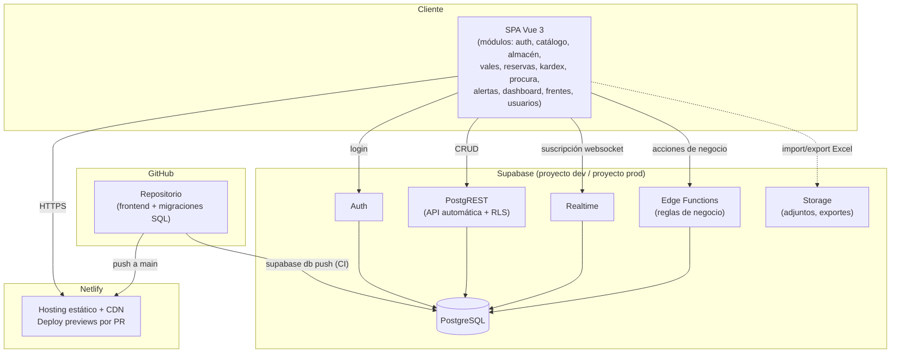
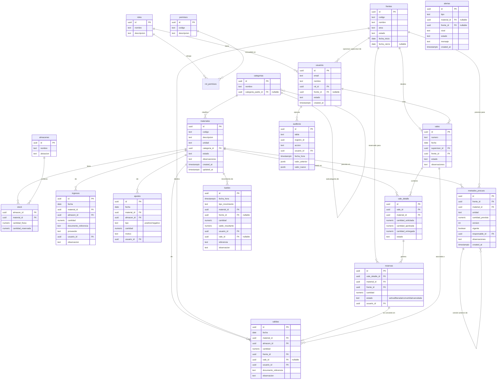
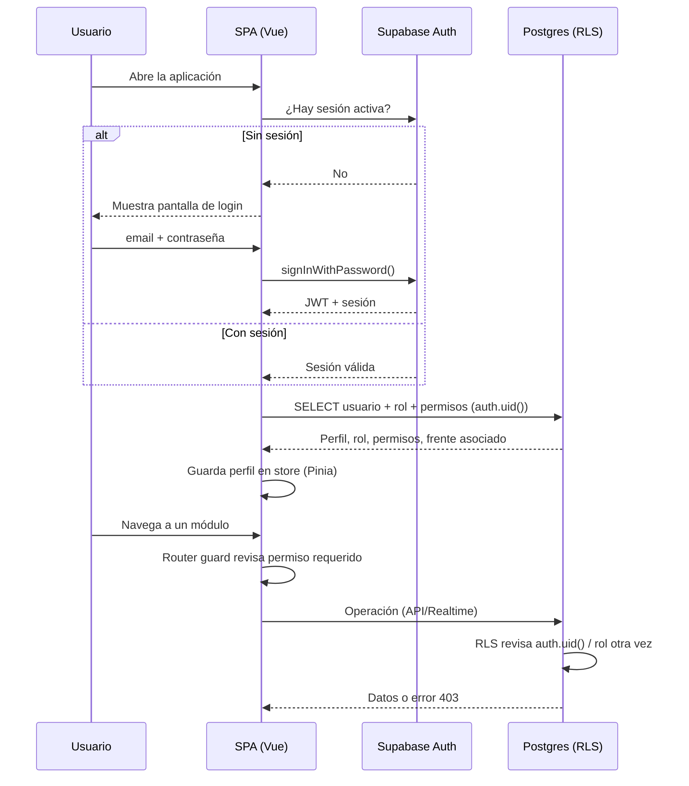
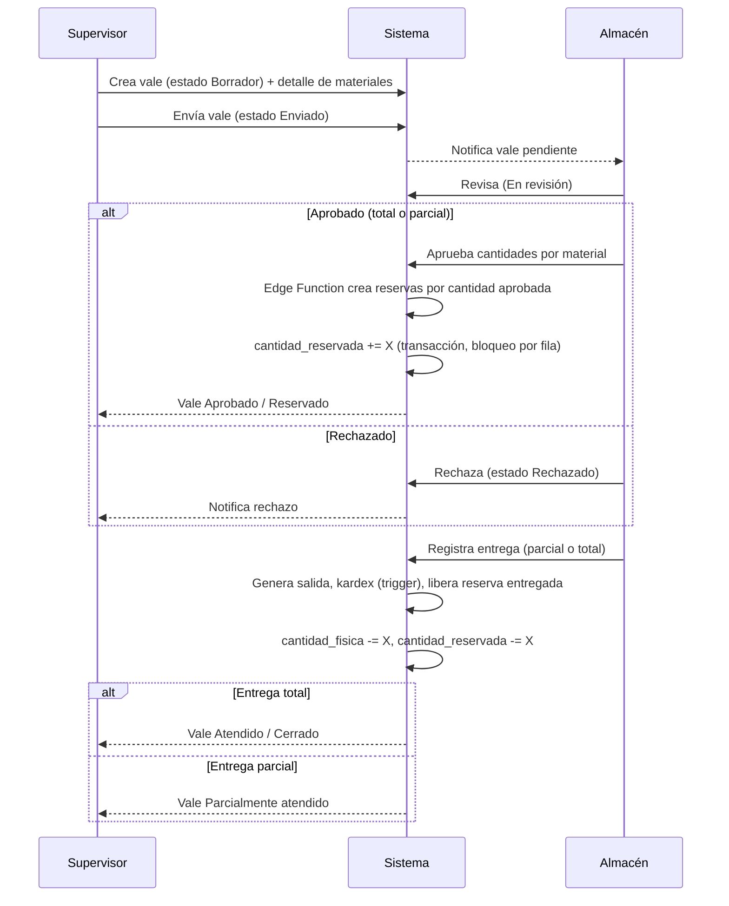

# Arquitectura — Sistema de Gestión de Materiales y Procura

Estado: **Propuesta para revisión** (Fase 1 según especificación maestra, sección 22).
Este documento cubre los 10 entregables solicitados antes de programar. No se ha
implementado ningún módulo funcional todavía — solo se documenta la arquitectura.

---

## 1. Arquitectura propuesta

**Frontend** — SPA modular con **Vue 3 (Composition API) + Vite**, `vue-router` para
navegación, `Pinia` para estado, `@supabase/supabase-js` como cliente de datos.
Se recomienda Vue sobre JavaScript vanilla puro porque la especificación exige
componentes reutilizables, muchos módulos con estado compartido (stock, reservas,
vales) y actualizaciones en tiempo real — reactividad nativa evita reimplementar
un sistema de binding a mano. Sigue siendo HTML/CSS/JS: los `.vue` compilan a
esos tres lenguajes, no introduce un runtime ajeno al espíritu de la sección 4.
**Esta elección queda abierta a confirmación** (ver sección 10).

**Backend** — En vez de un servidor Node/Express propio, se propone **Supabase**
como backend-as-a-service sobre Postgres:
- **PostgREST** genera la API REST automáticamente a partir del esquema.
- **Row Level Security (RLS)** aplica las reglas de permisos *en la base de datos*,
  no solo en el frontend (requisito de la sección 18).
- **Edge Functions** (Deno/TypeScript) para lógica de negocio que no cabe en RLS:
  aprobar un vale, convertir una reserva en salida, recalcular kardex.
- **Realtime** (basado en replicación lógica de Postgres) para stock, vales y
  reservas en vivo.
- **Auth** integrado, con tabla de perfiles propia para roles y permisos.

**Base de datos** — PostgreSQL administrado por Supabase.

**Hosting** — Netlify para el frontend (build estático de Vite), con *deploy
previews* automáticos por pull request y despliegue a producción desde `main`.

**Control de versiones** — Git/GitHub. Las migraciones de base de datos viven
como archivos SQL versionados en el repo (`backend/supabase/migrations/`) y se
aplican con Supabase CLI — así un cambio de esquema pasa por el mismo flujo de
revisión que el código, sin tocar producción a mano.

### Por qué este stack y no un backend custom
Un servidor propio (Express, NestJS, etc.) daría más control pero duplicaría
trabajo que Supabase ya resuelve (auth, API, realtime, backups) y añadiría un
proceso más que desplegar y mantener. Dado que el equipo es pequeño y el
requisito explícito es "evaluar Supabase", se adopta como backend principal;
Edge Functions cubren la lógica que no encaja en RLS/triggers puros.

---

## 2. Diagrama de componentes



---

## 3. Modelo entidad-relación

Convenciones: nombres de tabla en español y minúsculas, claves primarias `id`
(uuid), `created_at`/`updated_at` en todas las tablas operativas. El **kardex se
genera automáticamente por triggers** desde `ingresos`, `salidas`, `ajustes` y
`reservas` — nunca se inserta a mano desde la aplicación, para que no pueda
desincronizarse del resto del sistema.



Notas de diseño:
- `stock.cantidad_disponible` no se almacena: se calcula como
  `cantidad_fisica - cantidad_reservada` (columna generada o vista), para que
  nunca quede desincronizada.
- `metrados_procura` nunca se actualiza en sitio: cada edición inserta una fila
  nueva con `version + 1` y marca la anterior `vigente = false`, preservando
  historial completo (requisito sección 12).
- `auditoria` se llena vía triggers genéricos en las tablas críticas
  (`materiales`, `vales`, `stock`, `metrados_procura`, `usuarios`), no desde la
  aplicación, para que no se pueda omitir.
- Permisos como tabla (`roles` × `permisos` vía `rol_permisos`) en vez de un
  enum fijo, para poder crear roles nuevos sin cambiar código (requisito
  sección 5).

---

## 4. Estructura de carpetas propuesta

```
SistemaGestionDNV/
├── frontend/
│   ├── src/
│   │   ├── modules/                 # un folder por módulo funcional
│   │   │   ├── auth/
│   │   │   ├── usuarios/
│   │   │   ├── catalogo/
│   │   │   ├── frentes/
│   │   │   ├── almacen/             # ingresos, salidas, stock
│   │   │   ├── vales/
│   │   │   ├── reservas/
│   │   │   ├── kardex/
│   │   │   ├── procura/             # metrados + comparación
│   │   │   ├── alertas/
│   │   │   └── dashboard/
│   │   │       └── <modulo>/
│   │   │           ├── components/
│   │   │           ├── views/
│   │   │           ├── services/    # llamadas a Supabase específicas
│   │   │           ├── store/       # store Pinia del módulo
│   │   │           └── routes.js
│   │   ├── components/              # componentes compartidos (tabla, modal, etc.)
│   │   ├── services/                # supabaseClient.js, http helpers
│   │   ├── router/
│   │   ├── store/                   # setup global de Pinia
│   │   ├── styles/                  # variables CSS, tema
│   │   ├── utils/
│   │   ├── config/                  # config por entorno, feature flags
│   │   ├── App.vue
│   │   └── main.js
│   ├── public/
│   ├── index.html
│   ├── vite.config.js
│   ├── package.json
│   └── .env.example
├── backend/
│   └── supabase/
│       ├── migrations/              # SQL versionado, nunca se edita en producción a mano
│       ├── functions/               # Edge Functions (una por regla de negocio)
│       ├── policies/                # RLS organizadas por tabla
│       └── seed/                    # datos de prueba para dev, NUNCA producción
├── docs/
│   ├── ARQUITECTURA.md              # este documento
│   └── decisiones/                  # ADRs, una por decisión relevante
├── .github/
│   └── workflows/                   # lint, test, verificación de migraciones
├── netlify.toml
└── README.md
```

No se crea todavía este árbol físicamente (más allá de `docs/`): se documenta
para validarlo antes de generar archivos reales, según lo pedido en la sección 22.

---

## 5. Tecnologías y dependencias

| Capa | Elección | Alternativa considerada |
|---|---|---|
| Framework frontend | Vue 3 + Vite | Vanilla JS + Web Components |
| Estado | Pinia | Store manual con eventos |
| Estilos | CSS con variables + utilidades propias | Tailwind CSS |
| Cliente de datos | `@supabase/supabase-js` | fetch directo a PostgREST |
| Gráficos (dashboard) | Chart.js | ApexCharts |
| Excel import/export | SheetJS (`xlsx`) | ExcelJS |
| Backend | Supabase (Postgres + Auth + Realtime + Edge Functions) | Node/Express + Postgres propio |
| Migraciones | Supabase CLI | Prisma Migrate |
| Testing | Vitest (unit) + Playwright (e2e, fase posterior) | Jest + Cypress |
| CI/CD | GitHub Actions → Netlify + Supabase CLI | — |
| Lint/formato | ESLint + Prettier | — |

---

## 6. Flujo de autenticación



La validación ocurre **dos veces**: en el router (experiencia de usuario) y en
RLS/Edge Functions (seguridad real). El frontend nunca es la única barrera,
conforme a la sección 18.

---

## 7. Flujo de vale → reserva → salida



**Control de concurrencia**: la reserva de stock se hace dentro de una
transacción de Postgres con bloqueo de fila (`SELECT ... FOR UPDATE`) sobre
`stock`, para que dos vales no puedan comprometer el mismo material disponible
al mismo tiempo (requisito explícito de la sección 10). Esto se implementa en
una Edge Function o función de Postgres (`plpgsql`), nunca solo en el cliente.

---

## 8. Estrategia de despliegue

- **Ramas**: `main` = producción. Trabajo en ramas de feature, merge por Pull
  Request con revisión.
- **Frontend**: Netlify conectado al repo de GitHub. Cada PR genera un *deploy
  preview* con URL propia; merge a `main` despliega a producción
  automáticamente.
- **Backend**: dos proyectos Supabase separados — **desarrollo** y
  **producción** — para no arriesgar datos reales mientras se prueba. Las
  migraciones en `backend/supabase/migrations/` se aplican con Supabase CLI,
  idealmente vía GitHub Action al hacer merge a `main` (o manualmente al
  inicio, hasta tener CI listo).
- **Variables de entorno**: URL y llave anónima de Supabase se configuran en
  Netlify (por contexto: producción/preview), nunca hardcodeadas en el
  repositorio.
- **Orden recomendado**: aplicar migración de base de datos primero, luego
  desplegar frontend — así el frontend nunca asume un esquema que todavía no
  existe.

---

## 9. Estrategia de respaldo y recuperación

- Habilitar **backups automáticos diarios** de Supabase; evaluar **Point-in-Time
  Recovery (PITR)** en cuanto haya datos reales en producción (requiere plan
  pago de Supabase).
- Exportación periódica adicional (semanal) de tablas críticas —
  `materiales`, `stock`, `kardex`, `metrados_procura` — a Storage como
  respaldo secundario fuera del backup gestionado.
- Las migraciones deben ser **aditivas** cuando sea posible (agregar columnas
  en vez de renombrar/borrar); antes de una migración destructiva, respaldo
  manual explícito.
- No hay borrado físico de registros históricos críticos (kardex, vales,
  auditoría) — solo cambios de estado (`cancelado`, `inactivo`), conforme a la
  sección 16.
- Pendiente para una fase posterior: runbook de recuperación documentado en
  `docs/decisiones/`.

---

## 10. Riesgos y decisiones pendientes

| # | Decisión / riesgo | Recomendación | Necesita confirmación de |
|---|---|---|---|
| 1 | Framework frontend: Vue 3 vs. JS vanilla vs. React | Vue 3 + Vite | Negocio/equipo técnico |
| 2 | Backend: Supabase vs. servidor propio (Node/Express) | Supabase | Negocio/equipo técnico |
| 3 | Multi-almacén desde el inicio o solo uno | Incluir entidad `almacenes` desde ya (costo bajo, evita migración futura) | — |
| 4 | Matriz exacta de permisos por rol | Placeholder por defecto, debe validarse con cada área (Almacén, Supervisor, Planeamiento) | Áreas usuarias |
| 5 | Flujo exacto de aprobación de vales (¿quién aprueba, aprobación parcial por línea?) | El flujo de la sección 7 es un punto de partida | Almacén/Planeamiento |
| 6 | Umbral de "riesgo de sobreconsumo" | Configurable por sistema, default 90%, override opcional por material/frente | Planeamiento |
| 7 | Concurrencia en reservas | Transacción + bloqueo de fila en Postgres (sección 7) | — (ya resuelto a nivel de diseño) |
| 8 | Importación de Excel (catálogo, metrados) | Diferido a fase posterior, según sección 17 | — |
| 9 | Notificaciones por correo/Teams | Diferido a fase posterior, según sección 15 | — |
| 10 | ¿Un solo proyecto/organización o multi-tenant? | Se asume una sola organización (no multi-tenant) salvo indicación contraria | Negocio |
| 11 | Convención de nombres (español, como en este documento) | Confirmar antes de generar migraciones | Equipo técnico |

---

## Siguiente paso

Según la sección 22, el desarrollo módulo por módulo empieza **después** de
revisar y confirmar esta propuesta — en particular los puntos 1, 2 y 4–6 de la
tabla de riesgos, que condicionan el resto del trabajo.
