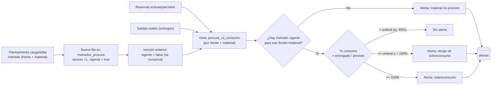

# Modelo de datos definitivo, permisos y flujos — Fase 2

Estado: **Propuesta para revisión** — construida sobre [`ARQUITECTURA.md`](./ARQUITECTURA.md),
ya aprobada como base (Vue 3 + Vite, Supabase/PostgreSQL, Netlify, GitHub).

Este documento incorpora las precisiones dadas tras la aprobación de fase 1:

1. Las **reservas no son salidas físicas** y no descuentan `cantidad_fisica`. Solo
   afectan `cantidad_disponible`. El Kardex refleja únicamente movimientos
   reales de almacén. Las reservas tienen su propio historial (`reservas_historial`),
   separado del Kardex.
2. Las **entregas parciales** de un vale se modelan como múltiples `salidas`
   contra la misma reserva, hasta agotar la cantidad aprobada/reservada.
3. **Multi-almacén** desde el inicio: `stock` es por par (almacén, material).
4. **Metrados Procura** sigue versionado, sin sobrescritura.
5. **Auditoría** de operaciones críticas, vía triggers genéricos.

Todavía no se implementa código funcional ni migraciones. Este documento es el
insumo para revisar antes de generarlas (punto 8 y 9 de tu aprobación).

---

## 1. Modelo de datos definitivo

### 1.1 Principio de diseño: stock físico vs. reservado

```
cantidad_fisica     → solo la tocan: ingresos, salidas, ajustes (movimientos reales)
cantidad_reservada  → solo la tocan: altas/bajas de reservas (compromiso, no movimiento)
cantidad_disponible → columna generada = cantidad_fisica - cantidad_reservada
```

`cantidad_reservada` en `stock` es una **caché mantenida por trigger** (suma de
reservas activas/parciales de ese almacén+material) — no la fuente de verdad;
la fuente de verdad es la tabla `reservas`. Esto mantiene el `SELECT ... FOR
UPDATE` simple para el control de concurrencia, sin recalcular una suma en
cada operación.

### 1.2 Diagrama entidad-relación

```mermaid
erDiagram
    roles ||--o{ usuarios : "tiene"
    roles ||--o{ rol_permisos : "otorga"
    permisos ||--o{ rol_permisos : "concedido en"
    frentes ||--o{ usuarios : "supervisor de (opcional)"
    categorias ||--o{ categorias : "subcategoría de"
    categorias ||--o{ materiales : "clasifica"
    almacenes ||--o{ stock : "contiene"
    materiales ||--o{ stock : "tiene"
    almacenes ||--o{ ingresos : "recibe en"
    materiales ||--o{ ingresos : "de"
    almacenes ||--o{ salidas : "despacha desde"
    materiales ||--o{ salidas : "de"
    almacenes ||--o{ ajustes : "de"
    materiales ||--o{ ajustes : "de"
    frentes ||--o{ vales : "destino"
    usuarios ||--o{ vales : "crea (supervisor)"
    vales ||--o{ vale_detalle : "contiene"
    materiales ||--o{ vale_detalle : "solicitado"
    vale_detalle ||--o{ reservas : "genera (al aprobar)"
    almacenes ||--o{ reservas : "reserva en"
    frentes ||--o{ reservas : "para"
    reservas ||--o{ reservas_historial : "registra cambios de"
    reservas ||--o{ salidas : "se entrega mediante (1..N parciales)"
    materiales ||--o{ kardex : "movimiento de"
    almacenes ||--o{ kardex : "en"
    frentes ||--o{ metrados_procura : "previsto para"
    materiales ||--o{ metrados_procura : "previsto"
    usuarios ||--o{ auditoria : "ejecuta"
    materiales ||--o{ alertas : "sobre (opcional)"
    frentes ||--o{ alertas : "sobre (opcional)"

    usuarios {
        uuid id PK "= auth.users.id"
        text email
        text nombre
        uuid rol_id FK
        uuid frente_id FK "nullable, si es supervisor"
        text estado
    }
    roles { uuid id PK; text nombre; text descripcion }
    permisos { uuid id PK; text codigo; text modulo; text descripcion }
    rol_permisos { uuid rol_id FK; uuid permiso_id FK }
    frentes {
        uuid id PK; text codigo; text nombre; text area
        text estado; date fecha_inicio; date fecha_cierre
    }
    categorias { uuid id PK; text nombre; uuid categoria_padre_id FK }
    materiales {
        uuid id PK; text codigo; text descripcion; text unidad
        uuid categoria_id FK; text estado; text observaciones
    }
    almacenes { uuid id PK; text codigo; text nombre; text ubicacion; text estado }
    stock {
        uuid almacen_id FK; uuid material_id FK
        numeric cantidad_fisica
        numeric cantidad_reservada "caché, mantenida por trigger"
        numeric cantidad_disponible "columna generada"
    }
    ingresos {
        uuid id PK; date fecha; uuid material_id FK; uuid almacen_id FK
        numeric cantidad; text documento_referencia; text proveedor; uuid usuario_id FK
    }
    salidas {
        uuid id PK; date fecha; uuid material_id FK; uuid almacen_id FK
        numeric cantidad; uuid frente_id FK; uuid vale_detalle_id FK "nullable"
        uuid reserva_id FK "nullable"; uuid usuario_id FK; text documento_referencia
    }
    ajustes {
        uuid id PK; date fecha; uuid material_id FK; uuid almacen_id FK
        text tipo "positivo/negativo"; numeric cantidad; text motivo; uuid usuario_id FK
    }
    vales {
        uuid id PK; text numero; date fecha; uuid supervisor_id FK
        uuid frente_id FK; text estado; text observaciones
    }
    vale_detalle {
        uuid id PK; uuid vale_id FK; uuid material_id FK
        numeric cantidad_solicitada; numeric cantidad_aprobada
        numeric cantidad_entregada "caché = suma de salidas"; text estado
    }
    reservas {
        uuid id PK; uuid vale_detalle_id FK; uuid material_id FK
        uuid almacen_id FK; uuid frente_id FK; numeric cantidad
        numeric cantidad_entregada "caché = suma de salidas de esta reserva"
        text estado "activa/parcial/liberada/convertida/cancelada"
        uuid usuario_id FK
    }
    reservas_historial {
        uuid id PK; uuid reserva_id FK; text estado_anterior; text estado_nuevo
        numeric cantidad_anterior; numeric cantidad_nueva
        text motivo; uuid usuario_id FK; timestamptz fecha_hora
    }
    kardex {
        uuid id PK; timestamptz fecha_hora
        text tipo_movimiento "ingreso/salida/ajuste_positivo/ajuste_negativo"
        uuid material_id FK; uuid almacen_id FK; numeric cantidad
        numeric saldo_resultante; uuid usuario_id FK
        text referencia_tabla; uuid referencia_id "apunta a ingresos/salidas/ajustes"
        uuid vale_id FK "nullable"; text observacion
    }
    metrados_procura {
        uuid id PK; uuid frente_id FK; uuid material_id FK; text unidad
        numeric cantidad_prevista; int version; boolean vigente
        uuid responsable_id FK; text observaciones
    }
    alertas {
        uuid id PK; text tipo; text nivel; uuid material_id FK "nullable"
        uuid frente_id FK "nullable"; uuid almacen_id FK "nullable"
        uuid vale_id FK "nullable"; text mensaje; text estado
        timestamptz created_at; timestamptz resuelta_at; uuid resuelta_por FK
    }
    auditoria {
        uuid id PK; text tabla; uuid registro_id; text accion
        uuid usuario_id FK; timestamptz fecha_hora
        jsonb valor_anterior; jsonb valor_nuevo
    }
```

### 1.3 Parámetros configurables (nuevo, por aprobación de §6)

Los umbrales de alertas y el stock mínimo deben poder ajustarse sin una
migración. Se agrega una tabla de configuración clave-valor:

```
configuracion {
  text clave PK          -- 'umbral_riesgo_sobreconsumo', 'dias_reserva_prolongada'
  jsonb valor
  text descripcion
  timestamptz updated_at
  uuid actualizado_por FK
}
```

Editable solo con el permiso `alertas.configurar_umbrales`. Valores semilla:
`umbral_riesgo_sobreconsumo = 90`, `dias_reserva_prolongada = 15`.

Además, `stock` y `materiales` incorporan el umbral de stock mínimo aprobado
en el punto 3 de §6:

- `materiales.stock_minimo_default` (numeric, nullable) — valor por defecto.
- `stock.stock_minimo` (numeric, nullable) — override por par almacén+material;
  si es `null`, se usa el default del material.

### 1.4 Por qué el Kardex ya no incluye "reserva" / "liberación de reserva"

La especificación original (sección 11) listaba `reserva` y `liberación de
reserva` como tipos de movimiento de Kardex. Con tu precisión #3, esto cambia:
**el Kardex es exclusivamente el libro de movimientos físicos reales**
(ingreso, salida, ajuste). El ciclo de vida de una reserva —creada, reducida
por entrega parcial, liberada, cancelada— se registra en `reservas_historial`,
una tabla propia. Esto evita que el Kardex "físico" mezcle compromisos con
movimientos reales, que es exactamente el problema que señalaste.

### 1.5 Tablas principales y sus relaciones (explicación funcional)

| Tabla | Qué representa | Se relaciona con |
|---|---|---|
| `materiales` | Catálogo maestro, información de referencia | `categorias`; referenciada por casi todo el resto |
| `almacenes` | Cada ubicación física de almacenamiento | `stock`, `ingresos`, `salidas`, `ajustes`, `reservas` |
| `stock` | Existencia de un material en un almacén (física + reservada) | clave compuesta `(almacen_id, material_id)` |
| `frentes` | Frente de trabajo que consume materiales | `vales`, `salidas`, `reservas`, `metrados_procura` |
| `ingresos` / `ajustes` | Movimientos que aumentan o corrigen stock físico | generan filas en `kardex` |
| `vales` / `vale_detalle` | La solicitud del supervisor y su detalle línea a línea | `vale_detalle` genera `reservas` al aprobarse |
| `reservas` | El compromiso de stock disponible para un `vale_detalle` aprobado | vive independiente del Kardex; se resuelve con 1..N `salidas` |
| `reservas_historial` | Auditoría específica del ciclo de vida de cada reserva | una fila por cada cambio de estado/cantidad |
| `salidas` | Entrega física real (puede haber varias por reserva = entregas parciales) | descuenta `cantidad_fisica`, genera `kardex`, reduce la reserva |
| `kardex` | Libro histórico de movimientos físicos reales, generado por trigger | nunca se inserta a mano desde la aplicación |
| `metrados_procura` | Cantidad prevista por frente+material, versionada | comparado contra `reservas` + `salidas` para el módulo de consumo |
| `alertas` | Resultado de evaluar umbrales (stock, procura, reservas) | referencia opcionalmente material/frente/vale |
| `auditoria` | Rastro genérico de quién cambió qué en tablas críticas | poblada por triggers, no por la aplicación |
| `configuracion` | Parámetros ajustables (umbrales, días) sin migración | leída por el job de alertas |
| `roles` / `permisos` / `rol_permisos` | Catálogo de roles, permisos y su asignación | 100% editable por el Administrador, sin tocar código (ver §2.1) |

---

## 2. Matriz de roles y permisos

### 2.1 Principio: la asignación es dato, no código (aprobado)

Confirmaste que **el Administrador decide qué permisos tiene cada rol**, y
que pueden reasignarse. Esto ya estaba implícito en el diseño (`roles` +
`permisos` + `rol_permisos` como tablas), y ahora queda como principio
explícito: la matriz de abajo es el **seed inicial** cargado en la primera
migración, no una restricción fija en el código. El Administrador podrá, desde
una pantalla de administración (`roles.gestionar`):

- Crear un rol nuevo (por ejemplo, un rol distinto para un "jefe de almacén")
  sin ninguna migración ni redeploy.
- Conceder o quitar cualquier permiso a cualquier rol.

**Resolución del punto 1 de §6** ("Almacén y/o un jefe distinto, ambos con
acceso"): el seed inicial concede `vales.aprobar_rechazar` a **Almacén** (y a
Administrador, que ya tiene todo). Si en la operación real existe una figura
de "jefe de almacén" distinta, el Administrador crea ese rol y le asigna el
mismo permiso — sin tocar código, exactamente como pide este principio.

Roles: **ADM** Administrador · **ALM** Almacén · **SUP** Supervisor ·
**PLA** Planeamiento · **CAT** Responsable de Catálogo · **CON** Consulta.

Convención de código: `modulo.accion`. Todos los permisos de "ver" quedan
además acotados por RLS al alcance del usuario (p. ej. un Supervisor solo ve
sus propios vales y el Kardex de su frente), aunque el permiso general esté
marcado ✓.

| Permiso | ADM | ALM | SUP | PLA | CAT | CON |
|---|:-:|:-:|:-:|:-:|:-:|:-:|
| **Usuarios y roles** | | | | | | |
| `usuarios.ver` | ✓ | — | — | — | — | — |
| `usuarios.crear` | ✓ | — | — | — | — | — |
| `usuarios.editar` | ✓ | — | — | — | — | — |
| `usuarios.desactivar` | ✓ | — | — | — | — | — |
| `roles.gestionar` | ✓ | — | — | — | — | — |
| **Catálogo** | | | | | | |
| `catalogo.ver` | ✓ | ✓ | ✓ | ✓ | ✓ | ✓ |
| `catalogo.crear` | ✓ | — | — | — | ✓ | — |
| `catalogo.editar` | ✓ | — | — | — | ✓ | — |
| `catalogo.desactivar` | ✓ | — | — | — | ✓ | — |
| `catalogo.importar_exportar` | ✓ | — | — | — | ✓ | — |
| **Frentes** | | | | | | |
| `frentes.ver` | ✓ | ✓ | ✓ (propio) | ✓ | — | ✓ |
| `frentes.crear` | ✓ | — | — | ✓ | — | — |
| `frentes.editar` | ✓ | — | — | ✓ | — | — |
| `frentes.cerrar` | ✓ | — | — | ✓ | — | — |
| **Almacenes y stock** | | | | | | |
| `almacenes.gestionar` | ✓ | — | — | — | — | — |
| `stock.ver` | ✓ | ✓ | ✓ (disponible) | ✓ | — | ✓ |
| `stock.registrar_ingreso` | ✓ | ✓ | — | — | — | — |
| `stock.registrar_ajuste` | ✓ | ✓ | — | — | — | — |
| **Vales** | | | | | | |
| `vales.crear` | ✓ | — | ✓ | — | — | — |
| `vales.editar_propio` | ✓ | — | ✓ (borrador) | — | — | — |
| `vales.enviar` | ✓ | — | ✓ | — | — | — |
| `vales.ver_propios` | ✓ | ✓ | ✓ | — | — | — |
| `vales.ver_todos` | ✓ | ✓ | — | ✓ | — | ✓ |
| `vales.aprobar_rechazar` | ✓ | ✓ | — | — | — | — |
| `vales.cancelar` | ✓ | ✓ | ✓ (propio, antes de aprobado) | — | — | — |
| **Reservas** | | | | | | |
| `reservas.ver` | ✓ | ✓ | ✓ (propias) | ✓ | — | ✓ |
| `reservas.liberar_manual` | ✓ | ✓ | — | — | — | — |
| **Salidas / entregas** | | | | | | |
| `salidas.registrar_entrega` | ✓ | ✓ | — | — | — | — |
| **Kardex** | | | | | | |
| `kardex.ver` | ✓ | ✓ | ✓ (su frente) | ✓ | — | ✓ |
| `kardex.exportar` | ✓ | ✓ | — | ✓ | — | — |
| **Metrados Procura** | | | | | | |
| `procura.ver` | ✓ | — | ✓ (su frente) | ✓ | — | ✓ |
| `procura.crear_version` | ✓ | — | — | ✓ | — | — |
| `procura.ver_comparacion` | ✓ | ✓ | ✓ (su frente) | ✓ | — | ✓ |
| **Alertas** | | | | | | |
| `alertas.ver` | ✓ | ✓ | ✓ (su frente) | ✓ | — | ✓ |
| `alertas.resolver` | ✓ | ✓ | — | ✓ (procura) | — | — |
| `alertas.configurar_umbrales` | ✓ | — | — | — | — | — |
| **Dashboard** | | | | | | |
| `dashboard.ver` | ✓ | ✓ | ✓ | ✓ | ✓ | ✓ |
| **Auditoría** | | | | | | |
| `auditoria.ver` | ✓ | — | — | — | — | — |
| **Reportes** | | | | | | |
| `reportes.exportar` | ✓ | ✓ | — | ✓ | — | ✓ |

Esta matriz alimenta directamente la tabla `permisos` + `rol_permisos`: se
implementa como datos (filas insertadas por migración/seed), no como reglas
escritas en el código de la aplicación — así un cambio de permisos futuro es
una operación de datos, no un redeploy.

Resuelto: `vales.aprobar_rechazar` para Almacén (y cualquier rol adicional
que el Administrador designe, ver §2.1); `frentes.crear/editar/cerrar` para
Planeamiento **y** Administrador.

---

## 3. Flujo definitivo: vale → aprobación → reserva → entrega parcial/total → salida → cierre

### 3.1 Estados

**Vale**: `Borrador` → `Enviado` → `En revisión` → (`Aprobado` | `Rechazado`) →
`Reservado` → (`Parcialmente atendido` → ) `Atendido` → `Cerrado`. En
cualquier punto antes de `Atendido`: `Cancelado`.

**Vale-detalle (línea)**: `Pendiente` → (`Aprobado` | `Rechazado`) →
`Reservado` → `Parcialmente entregado` → `Entregado`. En cualquier punto:
`Cancelado`.

**Reserva**: `Activa` → `Parcial` (tras la primera entrega parcial) →
`Convertida` (entregada al 100%). En cualquier punto antes de `Convertida`:
`Liberada` (sin entrega) o `Cancelada`.

### 3.2 Secuencia

```mermaid
sequenceDiagram
    participant S as Supervisor
    participant Sys as Sistema
    participant Al as Almacén

    S->>Sys: Crea vale (Borrador) + líneas (vale_detalle: Pendiente)
    S->>Sys: Envía vale (Enviado)
    Sys-->>Al: Notifica vale pendiente
    Al->>Sys: Revisa (En revisión)

    loop por cada línea del vale
        alt Aprobada (total o parcial)
            Al->>Sys: Aprueba cantidad_aprobada
            Sys->>Sys: TX: lock stock(almacen,material) FOR UPDATE
            Sys->>Sys: valida cantidad_aprobada <= cantidad_disponible
            Sys->>Sys: crea reserva (Activa) + stock.cantidad_reservada += X
            Sys->>Sys: reservas_historial: "creada"
            Sys-->>S: Línea Reservada
        else Rechazada
            Al->>Sys: Rechaza línea
            Sys-->>S: Línea Rechazada
        end
    end
    Sys->>Sys: vale.estado = Reservado (si hay al menos una línea reservada)

    loop hasta agotar cada reserva (1..N entregas)
        Al->>Sys: Registra entrega física de cantidad_entrega
        Sys->>Sys: TX: valida cantidad_entrega <= (reserva.cantidad - reserva.cantidad_entregada)
        Sys->>Sys: crea salida (kardex trigger); stock.cantidad_fisica -= X
        Sys->>Sys: stock.cantidad_reservada -= X (se libera la porción ya entregada)
        Sys->>Sys: reserva.cantidad_entregada += X; vale_detalle.cantidad_entregada += X
        alt cantidad_entregada == reserva.cantidad
            Sys->>Sys: reserva.estado = Convertida; línea = Entregado
        else
            Sys->>Sys: reserva.estado = Parcial; línea = Parcialmente entregado
        end
        Sys->>Sys: reservas_historial: "entrega_parcial" | "entrega_total"
    end

    Sys->>Sys: si todas las líneas = Entregado (o Rechazado/Cancelado) -> vale = Atendido
    Sys->>Sys: si queda alguna línea Parcialmente entregada sin más movimiento -> vale = Parcialmente atendido
    Al->>Sys: Cierra vale (Cerrado) — libera reservas residuales no completadas
```

### 3.3 Reglas duras (se validan en base de datos, no solo en el frontend)

- Una reserva **nunca** puede exceder `cantidad_disponible` al momento de
  crearse (lock de fila + validación en la misma transacción).
- Una entrega **nunca** puede exceder el saldo pendiente de su reserva
  (`reserva.cantidad - reserva.cantidad_entregada`).
- `cantidad_fisica` solo cambia por `ingresos`, `salidas` o `ajustes` —
  jamás por altas/bajas de `reservas`.
- Cancelar un vale o una línea libera su reserva (`Liberada`) y revierte
  `stock.cantidad_reservada`, sin tocar `cantidad_fisica`.

---

## 4. Flujo: Metrados Procura → consumo → alertas



La comparación (`prevista`, `reservada`, `solicitada`, `entregada`, `saldo`,
`% consumo`, `desviación`) se implementa como **vista de base de datos**, no
como tabla física — se recalcula en cada consulta a partir de
`metrados_procura` (vigente), `reservas` y `salidas`, así nunca queda
desactualizada. Un job periódico (Edge Function programada / `pg_cron`) evalúa
los umbrales sobre esa vista y escribe/actualiza filas en `alertas`, junto con
las alertas no ligadas a procura (stock bajo/agotado, reserva prolongada).

---

## 5. Estructura inicial de carpetas

Sin cambios sustanciales respecto a la fase 1; se añade `reservas_historial`
y la vista de comparación en `backend/supabase/`. Todavía **no se crea** este
árbol físicamente (excepto `docs/`) — se generará al iniciar la implementación.

```
SistemaGestionDNV/
├── frontend/
│   └── src/
│       ├── modules/
│       │   ├── auth/  usuarios/  catalogo/  frentes/
│       │   ├── almacen/        # ingresos, ajustes, stock por almacén
│       │   ├── vales/
│       │   ├── reservas/       # incluye vista de reservas_historial
│       │   ├── kardex/
│       │   ├── procura/        # metrados + vista procura_vs_consumo
│       │   ├── alertas/
│       │   └── dashboard/
│       ├── components/  services/  router/  store/  styles/  utils/  config/
├── backend/
│   └── supabase/
│       ├── migrations/         # incluye vistas (procura_vs_consumo, stock_disponible)
│       ├── functions/          # Edge Functions: aprobar-linea, registrar-entrega,
│       │                       #   evaluar-alertas (job programado)
│       ├── policies/           # RLS por tabla, alineadas a la matriz de §2
│       └── seed/                # datos de prueba únicamente
├── docs/
│   ├── ARQUITECTURA.md
│   ├── MODELO_DATOS_Y_FLUJOS.md   # este documento
│   └── decisiones/
├── .github/workflows/
├── netlify.toml
└── README.md
```

---

## 6. Decisiones técnicas — resueltas

Todos los puntos quedaron aprobados. Se documenta la resolución final de cada
uno para que quede trazado en el modelo:

| # | Decisión | Resolución |
|---|---|---|
| 1 | ¿Quién aprueba/rechaza vales? | **Almacén y/o un rol "jefe" distinto — ambos con acceso.** El seed concede el permiso a Almacén; un rol adicional puede recibir el mismo permiso en cualquier momento, sin migración (ver §2.1). |
| 2 | ¿Quién gestiona frentes? | **Planeamiento y Administrador.** |
| 3 | Umbral de "stock mínimo" | **Por par material+almacén, con default opcional a nivel material.** Campos agregados: `materiales.stock_minimo_default`, `stock.stock_minimo` (ver §1.3). |
| 4 | Días para "reserva prolongada" | **Configurable, default 15 días**, en la tabla `configuracion`. |
| 5 | Umbral de "riesgo de sobreconsumo" | **Configurable, default 90%**, en la tabla `configuracion`. |
| 6 | ¿El vale especifica almacén? | **No — Almacén decide el almacén de origen al aprobar/reservar.** |
| 7 | ¿`reservas_historial` tabla propia? | **Sí, tabla propia.** |
| 8 | ¿Consulta puede exportar? | **Sí.** |
| 9 | *(nuevo)* ¿Los permisos están fijos por rol? | **No — el Administrador puede conceder cualquier permiso a cualquier rol, incluyendo roles nuevos, sin código.** Ver §2.1. |

---

## Siguiente paso

Las migraciones SQL definitivas ya están escritas en
[`backend/supabase/migrations/`](../backend/supabase/migrations/) (esquema
completo, políticas RLS alineadas a la matriz de §2, triggers de
kardex/stock/reservas_historial/auditoría y el seed de
roles/permisos/configuración) — ver
[`backend/supabase/README.md`](../backend/supabase/README.md) para cómo
aplicarlas en cuanto exista un proyecto Supabase. Todavía no se ha
implementado ningún módulo de interfaz.
